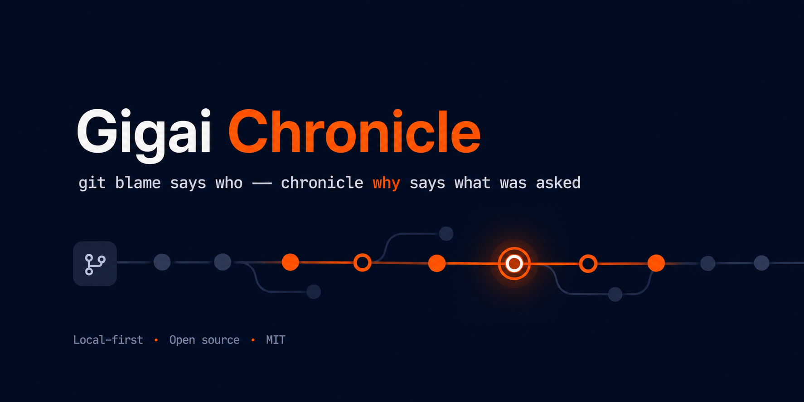

<p align="center">
  
</p>

# Gigai Chronicle — for VS Code, Cursor & Windsurf

> **Your AI development history — recorded in-repo, linked to git, replayable.**

Git records **what** changed. Gigai Chronicle records **what was asked** — the
prompts, the AI's responses, the tools it ran, the code it produced — as a
plain-text journey that lives inside your repository and travels by `git clone`
like everything else.

No account. No server. No network. It never calls a model.

---

## What it adds to your editor

### 🔍 Why is this file like this?
Right-click any file → **Chronicle: Why is this file like this?** `git blame`
tells you *you* wrote the line. Chronicle tells you **what you asked for** — the
prompt behind each change — and offers to put the code back to that moment.

### ▶️ Replay a session
Step through what actually happened: prompts, responses, tool runs, and commits
interleaved in order. Code review with the intent attached.

### 🕘 Sessions sidebar
Every AI session in the current repo, with **provider and model badges** — see
which AI did which work, grouped by day.

### 📚 Prompt version history
Your saved prompts as a **git-style graph** — versions, diffs in the native diff
editor, and a **Save prompt** button to keep the one that just worked (no
retyping).

### ⏪ One-click restore
Every captured prompt snapshots your working tree into a hidden git ref. Jump
back to how the code was at any prompt — always safety-checkpointed, so nothing
is ever lost.

### 📋 Copy context pack
Right-click any file → **Chronicle: Copy context pack**. Chronicle assembles the
prompts that shaped that file plus the decisions from those sessions into a
paste-ready brief — so your next AI session starts with what was already asked
and decided, instead of re-explaining the project. Pure assembly: it never calls
a model, it briefs the one you do.

### 📊 Dashboard: Commits, Files & Settings
The timeline is a workspace with tabs over one session. **Commits** and **Files**
show what the session actually changed — sourced from your real git history and
timed to the session's window (never fabricated). **Settings** is a read-only
view of your capture config and privacy posture — the dashboard only reads;
changing config stays a deliberate CLI action.

---

## Installation

```bash
code --install-extension gigaichronicle.gigaichronicle-vscode
```

Or search **Gigai Chronicle** in the Extensions view — in VS Code (Marketplace)
or in Cursor and Windsurf (Open VSX). A `.vsix` for every release is attached
to [GitHub Releases](https://github.com/cbsshekhawat18-lab/gigai-chronicle/releases).

**Requires the CLI for live capture: `npm i -g gigai-chronicle`.** The
extension wires the capture hooks into `.claude/settings.json`; those hooks run
the `chronicle` command, which the extension does not ship. Without it on your
PATH nothing is recorded — the extension warns you (with a one-click *Copy
install command*) and the sidebar shows **Hooks installed, CLI missing**
instead of "capture is live". After installing, restart your AI tool.

## Setup

Requires the CLI for live capture: `npm i -g gigai-chronicle` (see
[Installation](#installation)).

Open a git repo you work on with an AI tool — Chronicle starts recording it by
itself. In any other repo it asks once ("Start recording" / "Not now" / "Never
here") and remembers your answer. Nothing is written to a folder you only
opened, to a non-git folder, or to an untrusted workspace.

| `chronicle.autoStart` | |
| --- | --- |
| `auto` *(default)* | Start on its own where an AI tool is already in use; ask once anywhere else |
| `ask` | Always ask first |
| `off` | Never start on its own — use **Chronicle: Start recording this project** |

Starting creates `.chronicle/` and wires the capture hooks into
`.claude/settings.json` — the same thing `chronicle init` does from a terminal.
The hooks are safe to commit: a teammate without the CLI gets a quiet no-op,
never a hook error. Everything stays on your machine.

**Multi-root workspaces:** every folder gets its own store. The sidebar follows
the folder of the file you're editing, and *Start recording* asks which folder.

Then work normally — sessions appear in the sidebar. Already have history?
`chronicle import claude-code` backfills from transcripts you already have.

> Get the CLI and full docs:
> **[github.com/cbsshekhawat18-lab/gigai-chronicle](https://github.com/cbsshekhawat18-lab/gigai-chronicle)**

**Provider support today:** Claude Code (live capture) and **Codex** (import
your existing `~/.codex` history). Other tools are on the roadmap — the
extension shows their sessions as providers land.

## Commands

Every command, as it appears in the Command Palette:

| Command | What it does |
|---|---|
| **Chronicle: Start recording this project** | Create `.chronicle/` and wire capture — asks which folder in a multi-root window |
| **Chronicle: Open Dashboard** | The dashboard: timeline, replay, Commits/Files, prompts, memory, settings |
| **Chronicle: Replay Session** | Step through a session (from the sidebar) |
| **Chronicle: Refresh** | Re-read the store and capture state |
| **Chronicle: Why is this file like this?** | The prompt behind each change to a file, with restore |
| **Chronicle: Why NOT change this file?** | Recorded decisions, constraints and failed approaches touching a file |
| **Chronicle: Risk of this file** | An explainable risk score — every point a named signal |
| **Chronicle: Pre-flight a change (risk + history)** | Before you code: risks, contradictions, previous attempts |
| **Chronicle: Copy context pack (brief my AI tool)** | The prompts + decisions that shaped a file, to your clipboard |
| **Chronicle: Prepare AI Context (bootstrap a new agent)** | Rules + current state + next step, ready to paste |
| **Chronicle: Continue Previous Work** | A "continue where we left off" prompt |
| **Chronicle: Create Handoff** | An end-of-session handoff, saved to Project Memory and copied |
| **Chronicle: Search Project Memory** | Find decisions, constraints, issues, failed approaches |
| **Chronicle: Save a prompt to the library** | Keep a prompt you typed (or write a new one), versioned |
| **Chronicle: New prompt (write one for later)** | Author a fresh library prompt |
| **Chronicle: Save editor as prompt** | Turn the active editor (or selection) into a library prompt |
| **Chronicle: Import Codex sessions** | Backfill your `~/.codex` history for this repo |

Why, why-not, risk and context pack are also on the right-click menu for any
file (editor and Explorer). In an untrusted workspace, commands that write
(start, prompts, restore, handoff, import) ask you to trust the workspace
first.

## Works everywhere VS Code does

One codebase for **VS Code**, **Cursor**, and **Windsurf**. In untrusted
workspaces it runs read-only — it shows the journey (reading committed files is
what an editor does) but never captures.

## Privacy

- **Zero network by default** — `chronicle doctor` prints a proof on demand.
- **Never calls a model.** Never phones home. Your file contents never go into
  `.chronicle/` — but restore needs them, so each captured prompt **checkpoints
  your working tree as a snapshot in a local hidden git ref**
  (`refs/chronicle/ckpt/*`). Those refs stay on your machine: a normal
  `git push` doesn't send them.
- **Secrets are redacted at capture**, before anything reaches disk.
- **`--metadata-only`** mode records shapes and timings with no prompt text.
- **Sessions can be private** and promoted deliberately.
- **Never scores developers.** No leaderboards, ever.

⚠️ By default your journey is **shared** — it commits and pushes with your repo.
That's the point (a teammate clones and inherits the story), but it means your
prompts are as public as your repo. See the
[privacy model](https://github.com/cbsshekhawat18-lab/gigai-chronicle/blob/main/docs/privacy.md).

## License

MIT. Free and open — [source & spec](https://github.com/cbsshekhawat18-lab/gigai-chronicle).
